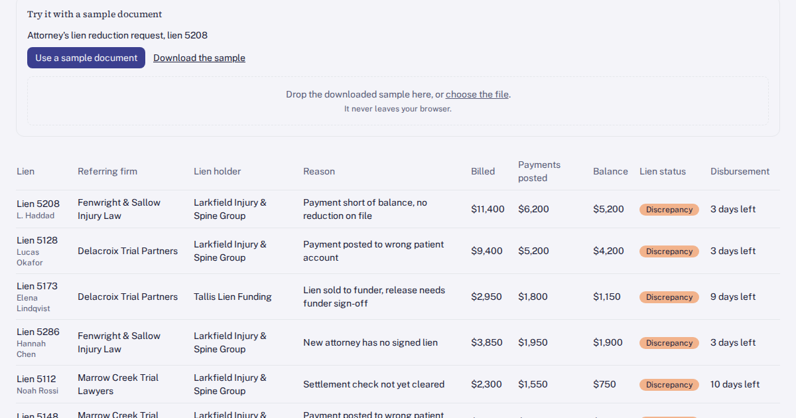

# Lien reconciliation and release desk for an injury practice

Every settled injury lien is checked against what was actually paid, and short payments are flagged before any lien release goes out.

## Who has this problem

Injury-first practices paid through PIP, letters of protection and workers' comp. Picture a multi-specialty group with orthopedics, spine, pain and physical therapy across four clinics: about 1,900 active injury cases and about 30 settled lien accounts to reconcile and release each week.

The lien and LOP coordinator gets settlement notices, reduction requests and release requests by email and fax. Each one gets matched to the patient ledger in the EHR by hand. The coordinator compares the posted check with the billed total, works out whether a reduction was agreed, and types the release letter from a Word template. Status lives in a spreadsheet and an inbox.

What goes wrong:

- Nobody has one list of which settled liens are paid in full, short-paid or still waiting on a check.
- Short payments are found after the release letter has gone out, so the difference is written off without anyone approving it. One release sent against a $6,200 check on an $11,400 bill writes off $5,200 that nobody approved.
- Liens sold to a funder are sometimes released without the funder's sign-off.
- Attorneys wait days for a release and call to ask, which strains the referral relationship.

At about 40 minutes per settled lien and 30 a week, that is roughly 20 coordinator hours a week.

## What you can try

The Start here screen lists four tasks. Each one ticks off when you finish it.

- **Open a lien ledger:** on Liens, click any row to see that lien's ledger and history, from the signed LOP to the posted check.
- **Fix the short-paid lien:** on Discrepancies, open lien 5208 ($6,200 paid on an $11,400 bill, flagged "Payment short of balance, no reduction on file", 3 days to the firm's disbursement deadline) and attach the attorney's reduction letter.
- **Send it to release review:** still on lien 5208, click Move to release review.
- **Approve the release:** on Release review, check lien 5208 and click Approve and send release. Nothing is written off and no release goes to a law firm until you click.

Also in the app:

- **Sample document:** the attorney's lien reduction request for lien 5208. Use it in one click or download it and upload it. The desk matches it to the lien and notes that the $6,200 offer is above the practice's $6,000 floor.
- **Role switcher:** switch between Lien and LOP coordinator, Billing and Attorney's view. Billing does not see the treatment summary. The attorney's view sees neither the treatment summary nor the practice's reduction floor.
- **Cost calculator:** enter your own settled-lien volume, minutes per lien and coordinator rate to compare today's cost with the desk.
- **How it works:** a clickable diagram. Click any box to see what it does, what data passes through it and whether it holds patient data.

## How it's built

A browser-only React + TypeScript + Tailwind app on the Umakes kit. All data is synthetic seed data: 140 liens, 70 payments and 320 lien notes across six invented law firms and one invented lien funder. State is kept in your browser, and Reset demo puts everything back.

It was built and checked by the Umakes App Factory: automated gates for build, routes, layout and accessibility, then a reviewer that uses the app the way a first-time visitor would, working through every task, the tour and each button.

The architecture screen shows where each piece of a real build would run: the law firm inbox, the EHR and billing ledger, the lien desk, an AI document reader that sees letter text only, the Microsoft Office release letter templates, the coordinator, the referring law firms and the lien funder.

## What a production version adds

- **Real integrations:** charges and posted payments read from the practice's EHR and billing ledger, settlement and reduction letters pulled from the law firm email and fax inbox, release letters filled from the practice's Microsoft Office templates, and status shared with the lien funder on purchased liens.
- **HIPAA controls:** role-based access, audit logs on every action, encryption in transit and at rest, and BAAs with every vendor that touches patient data. The document reader sees letter text only, never the chart.
- **Deployment on the client's own cloud:** it runs in the practice's own Google Cloud (GCP) account.
- **Client ownership:** the practice owns the code, the data and the deployment.

## Try it

https://umakescloud-max.github.io/lien-reconciliation-release-queue-v1/

This is a concept prototype with synthetic data. No real patients, practices or law firms are in it. A real build runs on the client's own cloud, HIPAA-ready, and the client owns it.

If your team fights this every week, book a free workflow audit at umakes.cloud or reply to umakescloud@gmail.com.
